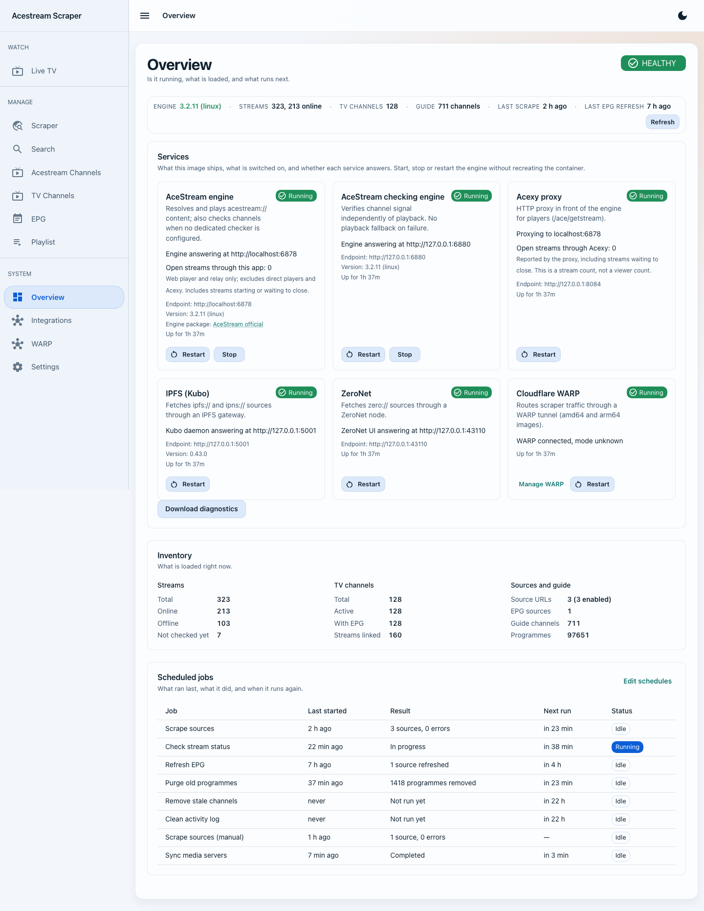

# Acestream Ids Scraper

Discover AceStream streams, organize your TV channels, and watch or share them with your favorite players — all from a self-hosted web app.

Scraper brings sources, programme guides, playlists, and playback together. Import links from web pages, playlists, JSON, text, ZeroNet, or IPFS, then turn them into a catalogue you can browse and maintain.

**[Get started](https://pipepito.github.io/acestream-scraper/)** · [Docker Hub](https://hub.docker.com/r/pipepito/acestream-scraper) · [Docs](https://github.com/Pipepito/acestream-scraper/wiki) · [Support on Ko-fi](https://ko-fi.com/pipepito)


*See what's on, pick a stream, and watch from your browser.*

## What you can do

- **Find and organize channels.** Collect AceStream IDs from multiple sources, match them to TV stations, and manage names, numbers, categories, favorites, and channel order.
- **Build your own source extractor.** Pick fields from an HTML sample, write a regular expression, or map JSON API fields to channel names and AceStream IDs. Start from the recipe catalogue, preview the results, and save the recipe to a source.
- **See what's on.** Import XMLTV programme guides and browse current and upcoming shows alongside your channels.
- **Watch in the browser.** Open Live TV, switch between available streams and audio tracks, or keep browsing while a channel plays.
- **Use the players you already have.** Generate M3U playlists, send channels to VLC or Kodi, or connect your catalogue to Jellyfin and Plex.
- **Keep your catalogue up to date.** Schedule source and guide refreshes, verify stream signal, and review job history and service health.
- **Inspect streams and storage.** See the latest measured peers, transfer rates, and media bitrate. Overview reports container data directories and mounts, their usage, and available filesystem space.
- **Choose your setup.** Use optional bundled services or connect your own AceStream engine, Acexy proxy, ZeroNet node, or IPFS gateway.

An engine is optional for scraping, playlist management, and supported broadcaster HTTP playback. AceStream playback and AceStream signal checks need a configured engine. Fresh installs contain no scraper sources or streams; you choose what to import.

## Get started

Use the **[Docker command builder](https://pipepito.github.io/acestream-scraper/)** to generate a command or Compose file for your machine, then follow the **[installation guide](https://github.com/Pipepito/acestream-scraper/wiki/Installation)** and **[first-run walkthrough](https://github.com/Pipepito/acestream-scraper/wiki/Usage)**.

### Set up with ChatGPT or a coding agent

Copy this prompt into ChatGPT for guided steps, or into your coding agent to have it run the setup:

```text
Help me set up https://github.com/Pipepito/acestream-scraper on my machine.
Read this repository's current README, AGENTS.md, wiki/Installation.md,
wiki/Configuration.md and wiki/Docker.md before choosing commands. Ask me
about my OS/CPU, Docker availability, storage folder, local or remote access,
and whether I need AceStream, HTTP broadcaster playback or media-server integration.
Prefer the stable release unless I request develop. Preserve existing files,
volumes, databases and secrets. Choose only the optional services I need and
explain required ports, mounts and permissions. Keep unauthenticated service
ports private. Never print credentials or commit my local configuration.
If you have shell access, inspect the machine, prepare and run the appropriate
Docker Compose setup, and verify startup, health and persistent storage.
If you cannot run commands, give me one step at a time and check the results.
Check which features are available in the selected release. When available,
open the web setup wizard (/setup), explain the runtime-config.json file beside
the database and that migrated environment values seed it only when absent.
Walk me through playback, access, authorized sources, programme guides,
TV channels, schedules and integrations. Use broadcaster-owned sources such
as Atresplayer only when I choose them; do not add third-party stream indexes,
paid-channel search presets or unsolicited scraper sources. Check a source
and playback only with content I am authorized to access. Finish with the local
app URL, verification results and backup/update instructions.
```

The development version includes a **web setup wizard** at `/setup`, also linked
from Settings. See [first-run configuration](wiki/Configuration.md#first-run-setup)
for file precedence, restart behavior and settings that stay in Docker.

## Extraction builder

Use **Scraper → Extraction builder** inside your installation to fetch a source, test a recipe, and save it. The [user tools page](https://pipepito.github.io/acestream-scraper/) brings **Docker setup**, **Extraction builder**, and **Docs** together. Its standalone builder works with pasted or uploaded HTML, text, or JSON; export the recipe and test it in your own scraper. Your installation does not need to be publicly accessible.

The starter catalogue provides editable examples. Sources without a recipe keep automatic extraction. The HTML preview is a sanitized snapshot: scripts, logins, and live page interactions do not run. Raw text and manual JSON paths are available when visual selection is unsuitable. See [extraction recipes](https://github.com/Pipepito/acestream-scraper/wiki/Extraction-Recipes) for instructions, sample limits, and troubleshooting.

## What's included in `latest`?

`pipepito/acestream-scraper:latest` is the full image: the web app and its optional companion software in one container.

| Software | What it does | With default settings |
|---|---|---|
| **Scraper web app** | Sources, TV channels, programme guides, playlists, and integrations | Starts automatically |
| **FFmpeg and ffprobe** | Prepare browser playback and inspect stream media | Used when needed |
| **AceStream Engine** | Connect to AceStream streams for playback and signal checks | Off until enabled |
| **Acexy** | Provide an HTTP proxy for AceStream playback | Off until enabled |
| **Cloudflare WARP** | Route outbound traffic through WARP | Off until enabled |
| **IPFS (Kubo)** | Fetch sources from IPFS and IPNS | Off until enabled |
| **ZeroNet and Tor** | Fetch sources through a local ZeroNet node, with optional Tor | Off until enabled |

**Included does not mean running.** With no service options set, `latest` starts the web app; the engine, proxy, and other optional services stay off. Enable the ones you want in the [Docker command builder](https://pipepito.github.io/acestream-scraper/). AceStream browser playback needs a bundled or external playback engine; supported broadcaster HTTP playback does not.

WARP, Kubo, ZeroNet, and Tor are bundled on **amd64 and arm64**. The app, FFmpeg, and the relevant engine/proxy variants also cover **arm/v7**, where bundled AceStream remains experimental. See [platform requirements](https://github.com/Pipepito/acestream-scraper/wiki/Requirements) for details.

## Choose your image

All tags below use the `pipepito/acestream-scraper` repository. Choose a smaller variant if you already run your own engine or don't need the proxy.

| Image tag | AceStream included | Acexy included | Best fit |
|---|---|---|---|
| **`latest`** | Yes | Yes | Full package for the current release |
| `scraper-acestream-acexy` | Yes | Yes | Explicit name for the same full package |
| `scraper-acestream` | Yes | No | Bundled engine, without Acexy |
| `scraper-acexy` | No | Yes | Acexy connected to your external engine |
| `scraper` | No | No | Scraping and playlists, or your own playback services |

**Every variant keeps the web app and FFmpeg**, plus WARP, Kubo, ZeroNet, and Tor on supported platforms. Changing the image selects which software is installed; the command builder selects which services start.

Use `latest` for the current release, `vX.Y.Z` or `vX.Y.Z-<flavor>` to pin a release, and `develop` or `develop-<flavor>` to try changes for the next one. See the [full image guide](https://github.com/Pipepito/acestream-scraper/wiki/Docker#image-tags-and-flavors) for setup details.

## A look inside

**Your channels, in your order.** Match streams to stations, choose favorites, and organize the catalogue you share with your players.


### Service dashboard

Check service health, control the engines, and review scheduled jobs from one place.



This example has optional services enabled. Your dashboard shows which components are installed, enabled, and running in your own setup.

The [illustrated walkthrough](https://github.com/Pipepito/acestream-scraper/wiki/Usage) covers importing sources, adding programme guides, and creating your first playlist.

## Explore the docs

| I want to… | Docs |
|---|---|
| Install, update, or migrate from v1 | [Installation and upgrades](https://github.com/Pipepito/acestream-scraper/wiki/Installation) |
| Choose services, ports, and storage | [Docker](https://github.com/Pipepito/acestream-scraper/wiki/Docker) · [Requirements](https://github.com/Pipepito/acestream-scraper/wiki/Requirements) |
| Manage channels, guides, and playlists | [Walkthrough](https://github.com/Pipepito/acestream-scraper/wiki/Usage) |
| Add a custom website or JSON API | [Extraction recipes](https://github.com/Pipepito/acestream-scraper/wiki/Extraction-Recipes) |
| Understand check results and disk usage | [Stream statistics](https://github.com/Pipepito/acestream-scraper/wiki/Stream-Statistics) · [Storage](https://github.com/Pipepito/acestream-scraper/wiki/Storage) |
| Watch in the browser | [Live TV and web player](https://github.com/Pipepito/acestream-scraper/wiki/Web-Player) |
| Use VLC, Kodi, Jellyfin, or Plex | [Remote players](https://github.com/Pipepito/acestream-scraper/wiki/Remote-Players) · [Media servers](https://github.com/Pipepito/acestream-scraper/wiki/Media-Servers) |
| Configure playback and automation | [Configuration](https://github.com/Pipepito/acestream-scraper/wiki/Configuration) |
| Solve a problem or report a bug | [Troubleshooting](https://github.com/Pipepito/acestream-scraper/wiki/Troubleshooting) · [Bug reporting](https://github.com/Pipepito/acestream-scraper/wiki/Bug-Reporting) |

## Contribute

Found a bug or have an idea? [Open an issue](https://github.com/Pipepito/acestream-scraper/issues). To help with source formats, see [contributing scraper data](https://github.com/Pipepito/acestream-scraper/wiki/Contributing-Scraper-Data).

For code contributions, start with the [development guide](https://github.com/Pipepito/acestream-scraper/wiki/Development) and [technical documentation](docs/README.md). Pull requests target `develop`.

## Support the project

If Acestream Scraper is useful to you, you can [support its development on Ko-fi](https://ko-fi.com/pipepito). Thank you for helping keep the project going.

Licensed under MIT.
