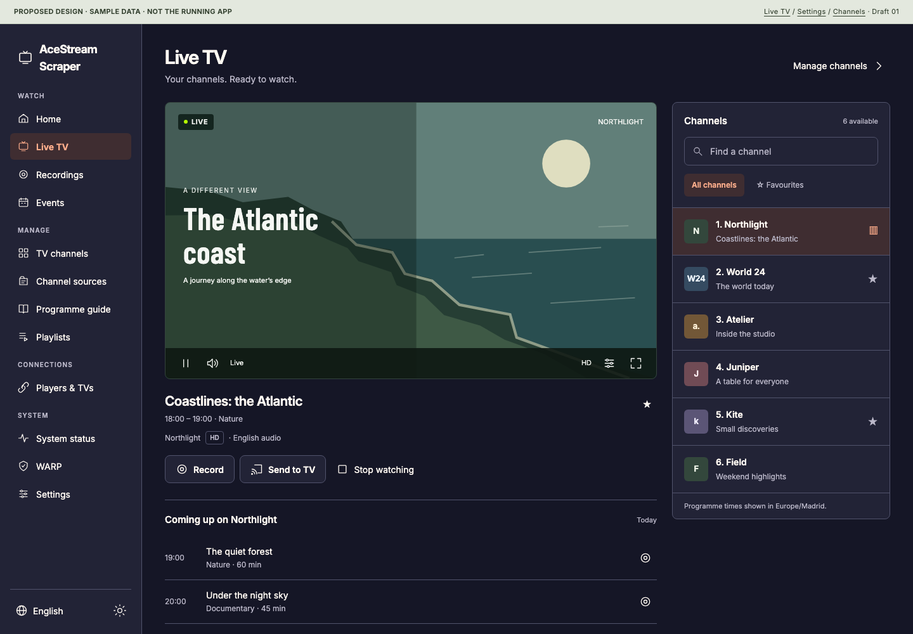
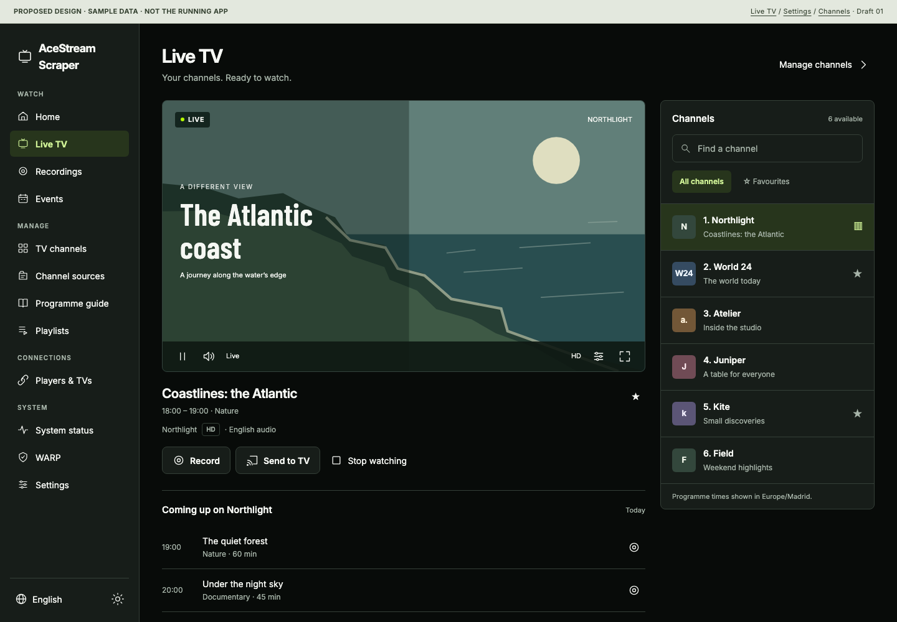
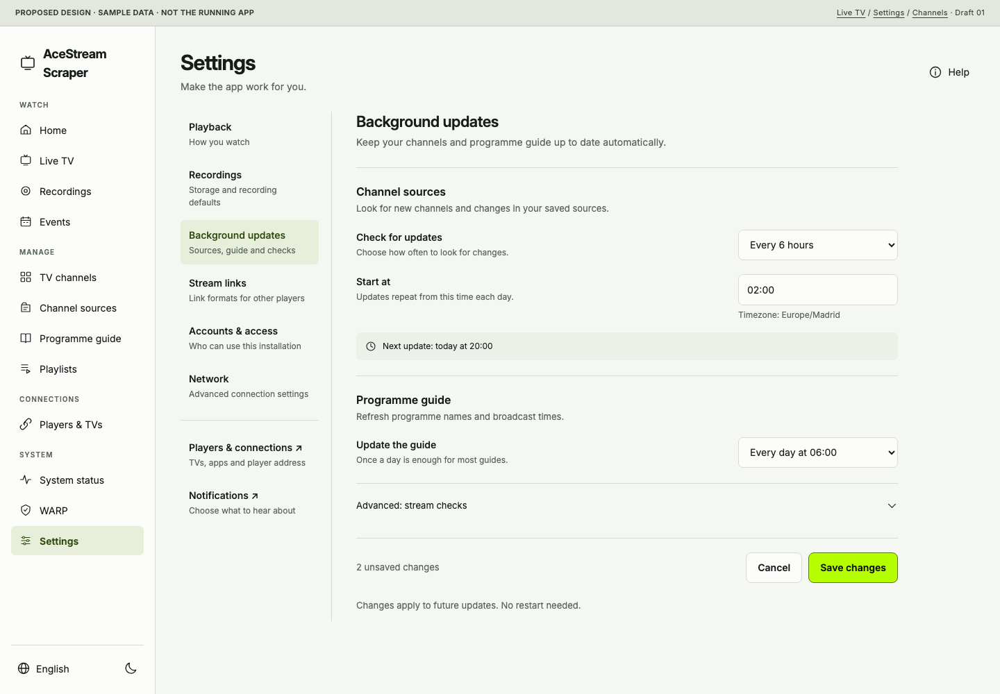
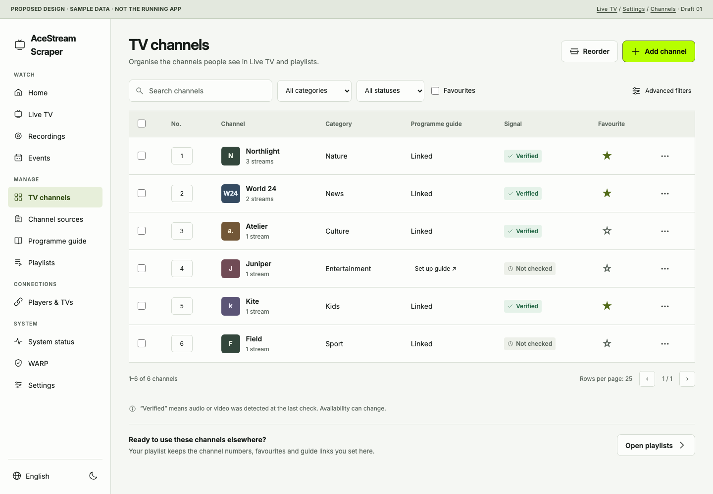
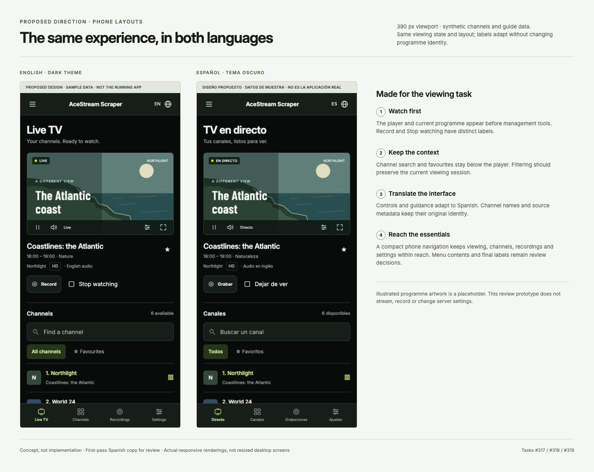
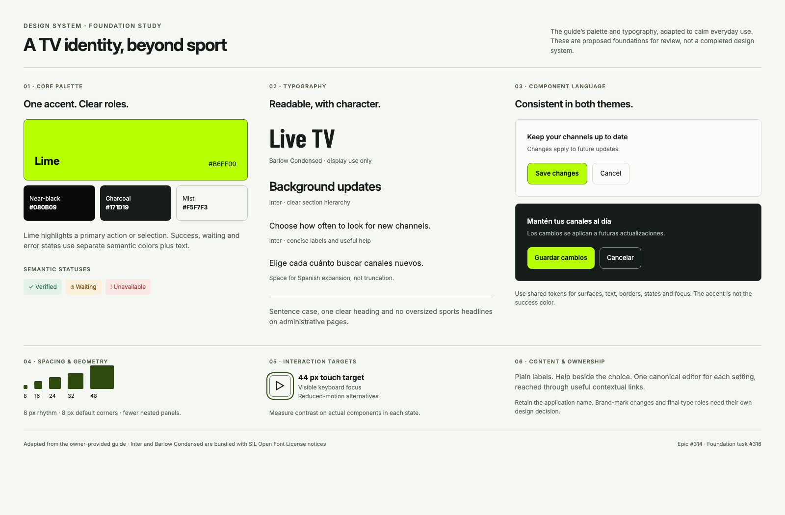
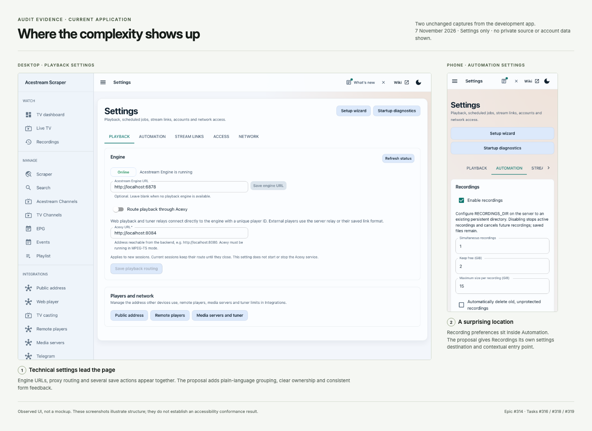

# Whole-app UX review — composed review 04

**Owner follow-up: design-only review is closed.** The next run implements epic #314, including the three referenced interfaces (lime, coral/navy and cyan), a user-facing selector, and required backend/incomplete-feature fixes. See the [confirmed implementation scope and task ownership](task-refinements-04.md#implementation-scope-confirmed-by-the-owner). This supersedes earlier instructions to choose one final visual direction. The selector and cyan production coverage are implementation work; they are not demonstrated by the existing two-palette prototypes.

The remaining design coverage for [epic #314](https://github.com/Pipepito/acestream-scraper/issues/314) is composed in **144 workflow screens, 473 field occurrences and 288 synthetic exports**, with EN/ES, both themes, phone/desktop, named states and comparable calm/expressive × coral/lime alternatives. **Design only: not user-approved or implemented.** Existing IBM Plex/teal standards remain authoritative.

Start with the [expanded visual gallery](workflow-gallery.html) and [interactive workflow prototype](workflow-prototype.html?screen=dashboard). GitHub displays HTML source: check out this branch and open the gallery locally. The prototype uses local scripts/data, blocks installation connections and contains no media or real credentials.

- [Completed coverage and important corrections](coverage-review-04.md)
- [Field-level workflow specification](workflow-specification.md) and [interaction contracts](interaction-contracts.md)
- [Traceability matrix](traceability-matrix.md), [current source-control map](source-control-map.md) and [schema evidence](source-contracts.md)
- [Current rendered verification and limits](verification-review-04.md)
- [Owner decisions and remaining acceptance protocols](acceptance-protocols.md)
- [Refined existing tasks #315–#324](task-refinements-04.md) and [new source finding F15](source-findings-04.md)

Current source was rechecked at develop `cf952af`; it has not advanced beyond the prior reconciliation. The live installation's exact revision remains unknown. No installation requests, application edits, dependency/runtime changes or supplier-code execution occurred in review 04. The prior private-HTTP recording crash, contrast/clipping issues and unnamed export sliders remain unresolved; performance slowdown remains unproven.

## Historical administration proposals · review 03

The following nine families and 26 exports record the preceding review. The new workflow package supersedes their incomplete coverage. Historical `prototype.html` is a viewing concept with placeholder/state limitations. Image 18 contains an obsolete manual Cast action; current source has bounded Cast discovery, and manual setup belongs to remote VLC/Kodi. The old single-save Settings concept is not an atomic-save contract.

Nine composed families, with desktop EN/light and phone ES/dark exports. All content is synthetic, including account/device/source names, guide identities, storage values and artwork. Original fictional channel/programme names stay unchanged between languages. These are **in review**, not finished whole-app design coverage.

| Family | Interactive proposal | Desktop / phone |
| --- | --- | --- |
| Recordings | [Open](admin-prototype.html?view=recordings) | [EN light](images/14-recordings-en.png) · [ES dark](images/14-recordings-es.png) |
| Guide matching | [Open](admin-prototype.html?view=guide) | [EN light](images/15-guide-en.png) · [ES dark](images/15-guide-es.png) |
| Accounts and access | [Open](admin-prototype.html?view=access) | [EN light](images/16-access-en.png) · [ES dark](images/16-access-es.png) |
| Source setup | [Open](admin-prototype.html?view=sources) | [EN light](images/17-sources-en.png) · [ES dark](images/17-sources-es.png) |
| Connections | [Open](admin-prototype.html?view=connections) | [EN light](images/18-connections-en.png) · [ES dark](images/18-connections-es.png) |
| System and storage | [Open](admin-prototype.html?view=system) | [EN light](images/19-system-en.png) · [ES dark](images/19-system-es.png) |
| First-run setup | [Open](admin-prototype.html?view=setup) | [EN light](images/20-setup-en.png) · [ES dark](images/20-setup-es.png) |
| Recovery | [Open](admin-prototype.html?view=recovery) | [EN light](images/21-recovery-en.png) · [ES dark](images/21-recovery-es.png) |
| Standalone helper | [Open](admin-prototype.html?view=helper) | [EN light](images/22-helper-en.png) · [ES dark](images/22-helper-es.png) |

## Compare the directions

The user requested alternatives. Compare the same recording content in [calm coral](admin-prototype.html?view=recordings&theme=dark&direction=calm&palette=coral), [calm lime](admin-prototype.html?view=recordings&theme=dark&direction=calm&palette=lime), [expressive coral](admin-prototype.html?view=recordings&theme=dark&direction=broadcast&palette=coral) and [expressive lime](admin-prototype.html?view=recordings&theme=dark&direction=broadcast&palette=lime). Change one variable at a time when judging. Recommendation: calm administration, optional expressive viewing titles; approval remains open.

[Guide changed](images/state-guide-conflict.png) · [Import failed after saving](images/state-sources-error.png) · [Permission consequences](images/state-access-destructive.png) · [Recovery confirmation](images/state-recovery-destructive.png). The state selector also includes relevant empty/loading/error/permission/unsaved states. It is not a complete feature state machine.

The new review **confirms the private-HTTP recording crash, status contrast failures and phone clipping**, adds unnamed guide-export sliders, and narrows performance/hierarchy claims to their evidence. No original product issue was resolved by these mockups. Missing detailed flows and acceptance work are explicit in the coverage delta. See [verification](verification.md) for commands, final counts and limitations.

---

## Historical draft 02 references

The material below records the earlier viewing studies and supplier previews. Its typography/palette and three-screen prototype are not the current administration specification; the fresh report corrects its over-broad reuse recommendation and draft-preservation limitations.

Visual references for [epic #314](https://github.com/Pipepito/acestream-scraper/issues/314), prepared on 7 November 2026 from the UX audit, owner-provided designer guide and subsequently supplied frontend bundle.

These are proposals for refinement. They do not change the application, establish final brand approval, or represent completed implementation tasks. The mockups use synthetic channels, programmes and settings. The illustrated player artwork is a placeholder, not live footage.

## Whole-app design requirement

The design must cover **everything**, including administration. The [whole-app coverage matrix and handoff contract](whole-app-coverage.md) maps every current route, settings/source/guide tab, embedded helper, gate and dialog family to an owner and required design deliverables. The current gallery is a set of concepts and references; it is not the complete design package. Task #316 must deliver that full package, and #324 must verify every surface.

## Designer bundle and reuse decision

Read the [coverage and reuse assessment](designer-frontend-assessment.md) for the native screens, missing capabilities, API differences, assets and verification. The supplied frontend is a useful viewing/discovery reference; its code is not a complete application replacement.

Its actual coral/navy styling differs from both the original lime PDF and an unused cyan proposal inside the bundle. Board 12 adapts the implemented palette to our general-TV layout. Final palette and font choices remain a refinement decision in #316.

| Reference | Purpose |
| --- | --- |
| [07 · Designer catalogue](images/07-designer-home-desktop.png) | Supplied desktop interface with synthetic channels. |
| [08 · Designer categories](images/08-designer-categories-desktop.png) | Discovery layout and sports-biased category fallbacks. |
| [09 · Designer sources](images/09-designer-sources-desktop.png) | Reusable add-and-extract flow. |
| [10 · Designer dashboard](images/10-designer-dashboard-desktop.png) | Backend-dependent summary; backend deliberately absent. |
| [11 · Designer phone layout](images/11-designer-home-phone.png) | Actual responsive catalogue at 390 px. |
| [12 · Coral general-TV study](images/12-coral-general-tv-study.png) | Optional adaptation; compare with the lime board 02. |
| [13 · Designer channel dialog](images/13-designer-player-dialog.png) | Player/detail presentation with no media session. |

Boards 07–11 and 13 are the supplied frontend rendered against intercepted synthetic data. They do not demonstrate a connected installation or working playback. Board 12 is our separate proposal.

## Original guide-based proposals

| Board | Purpose | Related tasks |
| --- | --- | --- |
| [01 · Current settings](images/01-current-state.png) | Two unchanged audit captures with annotations about technical controls and settings ownership. | #316, #318, #319 |
| [02 · Proposed Live TV](images/02-live-tv-desktop.png) | Dark desktop viewing layout with player, current programme and persistent channel catalogue. | #316, #319 |
| [03 · Proposed Settings](images/03-settings-desktop.png) | Light desktop settings, purposes/help, advanced disclosure and a consistent save area. | #316, #318 |
| [04 · Proposed TV channels](images/04-channels-desktop.png) | Visible core filters, numbers/favourites, guide links and honest signal states. | #316, #320 |
| [05 · Bilingual phone layouts](images/05-mobile-bilingual.png) | Actual 390 px EN/ES renders; interface labels translate while programme titles and channel names remain original. | #317, #318, #319 |
| [06 · Design foundations](images/06-design-foundations.png) | Guide-derived palette, font roles, spacing, focus targets, semantic states and both themes. | #316 |

## Standalone preview

Open [index.html](index.html) locally in a browser for the review gallery. Open [prototype.html](prototype.html) for the HTML/CSS concept. Keep its adjacent `assets/` directory so the fonts load. No network connection or installation configuration is required. Try the [coral/navy variant](prototype.html?view=live&theme=dark&palette=coral) alongside the default lime direction.

The prototype demonstrates three surfaces: Live TV, Settings and TV channels. EN/ES/theme controls, channel search/favourites and selected feedback are local demonstrations. Other navigation and actions are illustrative; it does not stream, record, authenticate, discover devices or change a server. Detailed behavior remains governed by the issue acceptance criteria, including state preservation during language changes.

The prototype is a disposable design reference outside the canonical frontend. Do not copy it wholesale into application source. Implementation should use the existing React/TypeScript/MUI patterns, typed localization resources and shared components described by the linked tasks.

## Decisions to refine

- Type roles, density and spacing; Inter for UI and limited Barlow Condensed display use are a proposal.
- Navigation labels and phone navigation. Some destinations are represented by grouped entry points, not removed capabilities.
- Canonical setting ownership and contextual links; the Settings mockup is an example section, not a complete field inventory.
- Final palette: original lime guide or implemented coral/navy direction, with semantic status colors kept separate; reconcile the unused cyan proposal.
- Final English/Spanish terminology and copy. Original channel/programme data stays outside UI translation.

The original designer PDF is not republished. The current-state board uses two settings captures selected to avoid private source lists, account details and public server addresses. Mockup channels and programmes are fictional.

## Evidence and limits

Planning/source baseline: `develop` at `7ccf16d383758aeeb78845e20e3716ddf97df10d`. The live audit installation's exact commit was not established.

- All 13 images were rendered and visually inspected. Six are supplied-frontend captures using synthetic data; one is current-app evidence; six are proposals.
- The final prototype passed 96 layout cases: Live TV, Settings and Channels × EN/ES × lime/coral × light/dark × 320/390/768/1440 px. No horizontal document overflow or script exceptions were observed. The initial export also had 30 screen/layout checks.
- Demonstration checks exercised language switching, channel search and local-only save feedback. The initial gallery loaded all six original images and linked to the prototype; the expanded gallery is checked separately below.
- Sample contrast ratios: main light text 15.89:1; secondary light text 5.56:1; dark text on lime 16.28:1; secondary dark text 7.86:1; success text 5.88:1; waiting text 6.28:1. These are sampled pairs, not a complete state audit.
- These checks do not constitute accessibility certification, application regression validation, or completion of any implementation task.

For this design-reference-only branch, the maintainer explicitly selected visual/prototype, documentation and link checks instead of the full application/Docker/E2E matrix. This scope-specific waiver does not apply to subsequent application implementation. The final repository documentation validator, local Markdown/HTML/CSS reference checks, expanded-gallery image/layout checks and whitespace checks passed. See [verification.md](verification.md) for commands, counts and scope.

## Asset provenance

Inter and Barlow Condensed were obtained from the official [Google Fonts repository](https://github.com/google/fonts). Their SIL Open Font License notices are included in [Inter-OFL.txt](assets/Inter-OFL.txt) and [Barlow-OFL.txt](assets/Barlow-OFL.txt); retain them when redistributing the font files.

The UI layouts, simple line icons and vector landscape are code-native review artwork. This branch does not introduce a new application name or brand mark.

The designer reference screenshots contain supplied artwork solely to review the supplied interface. Selected production assets still need the provenance checks described in the assessment; the original archive and media masters stay outside Git.
