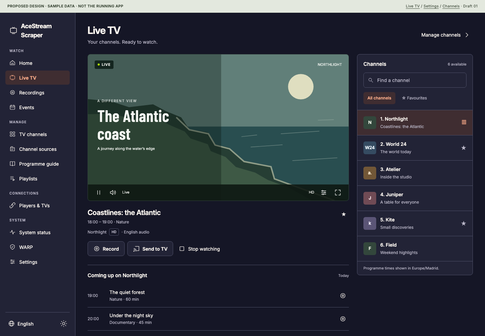
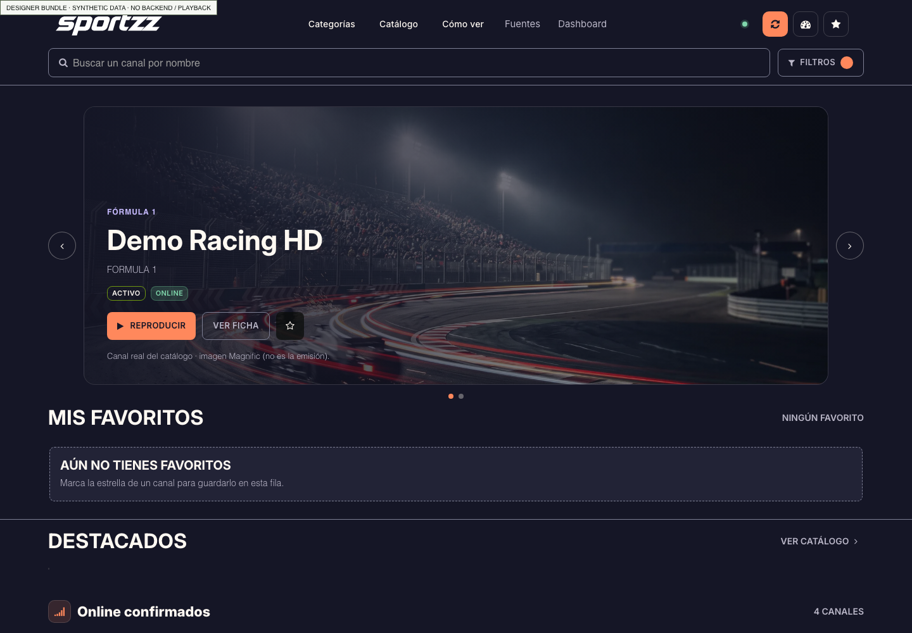
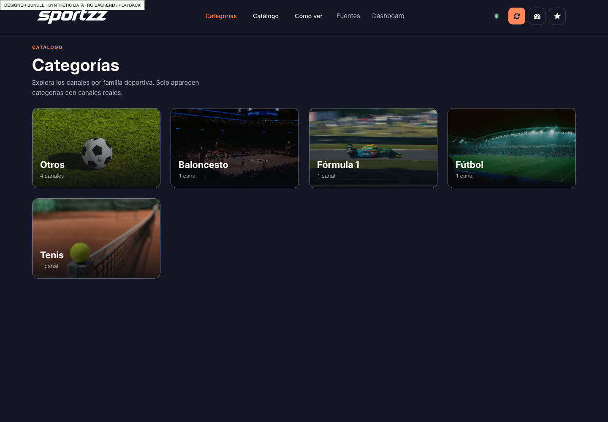
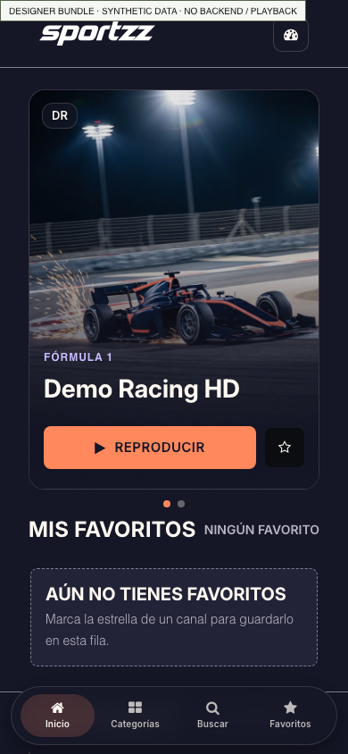

# Designer frontend: coverage and reuse assessment

Reviewed 7 November 2026 for [epic #314](https://github.com/Pipepito/acestream-scraper/issues/314). This assessment adds evidence to the existing ten tasks; it does not add another implementation backlog or approve a rebrand.

The owner explicitly requires the design to cover **the entire app, including all administration**. The [whole-app coverage and handoff contract](whole-app-coverage.md) is the scope authority; missing supplier screens remain required design work.

## Recommendation

Review 03 narrows this recommendation: selectively adapt viewing/discovery patterns and source entry, rather than adopt the whole visual system. Implement them as components in the existing React/TypeScript/MUI application, using its current services, permissions and media lifecycle. The bundle is a useful working design reference, but it is not a complete replacement for this application's frontend.

The visual language could be extended across the app. Replacing the application with the supplied code would leave recordings, guide management, playlists, accounts, most settings and integrations unimplemented, and would introduce a second backend contract.

A [coral/navy general-TV study](images/12-coral-general-tv-study.png) demonstrates one modest adaptation: the palette implemented by the designer, applied to our proposed viewing-first layout with general TV content and the application's existing name. It is a review option, not an accepted direction. The original lime proposal remains available for comparison.

## What was received and verified

- Archive: `sportzz-frontend.zip`, 193,765,939 bytes; 590 ZIP entries; 198,673,664 uncompressed bytes.
- SHA-256: `71347425454f9635c113f86618751fabe40e11ce26b2b54deb3dbecbe5dfaeb9`.
- Checked archive paths and entry types before extraction: no absolute/traversal paths or symlinks found. Extraction used bounded file and total sizes.
- Declared package version: `1.0.0`, private package. HTML, CSS, vanilla JavaScript, jQuery/legacy template plugins, bundled HLS library and media assets. No React source or mandatory bundler dependency tree is supplied.
- The original ZIP and extracted tree are preserved locally in the main checkout's already-ignored `downloads/design/` directory. The archive, original media masters and source tree were not bulk-imported into Git. The branch contains this assessment, reviewed screenshots and the separate general-TV prototype.
- No installation credentials were supplied to the package. Preview requests were intercepted and fulfilled with local assets or synthetic data; real network access and mutations were blocked. No stream or recording was started.

The supplier's README and audit document are useful context, but their claims are not substitutes for the independent checks described here.

## Actual coverage

`public/js/app-shell.js` defines five native view states: catalogue, categories, category detail, sources and dashboard. The channel/player dialog belongs to the catalogue. This is much narrower than the current application's route inventory.

| App capability | What the bundle supplies | Reuse / remaining work |
| --- | --- | --- |
| Viewer homepage | Featured carousel, favourites, discovery rows and catalogue cards | Strong visual reference. Adapt the emphasis and imagery to general TV and avoid promoting unknown availability as verified. |
| Live TV | Channel detail/player dialog and browser HLS client | Reuse visual controls selectively. The existing app's embedded player/catalogue and session ownership must remain authoritative. |
| Category browsing | Category grid and category detail views with responsive images/video | Useful discovery pattern; replace the sports-only taxonomy and generic sports fallbacks. |
| Recordings | No native recording library, scheduling or storage/retention editor | Existing task #319 still owns the full recording UX and safety consequences. |
| Channel sources | URL + Add and extract; source list; individual/bulk extraction | Reuse the one-primary-action flow. Current source types, recipes, queue handling and retention/delete semantics need the existing services. |
| AceStream discovery search | No equivalent; catalogue search filters already-loaded items | Keep the application's separate discovery/search capability. |
| Streams / TV channel management | Viewer cards, stream selection/failover helpers and local favourites | Not an editable inventory with numbering, server-owned favourites, atomic reorder, bulk management and guide assignments. |
| Programme-guide setup | No guide-source editor, reviewed matching/rules or XMLTV export UI | Task #320 remains necessary. A programme guide is not the sports-category view. |
| Events | No equivalent event-source/mapping/agenda administration | Do not mistake a featured sports channel for an imported event or schedule. |
| Playlist / stream-link settings | No equivalent complete editor/export flow | Keep the shared format editor, query options, guide identities and tokens. |
| Accounts, permissions and setup/recovery | No included equivalent | Preserve Settings → Access, startup gates and private-network HTTP support. |
| Casting, remote players, media servers | No native setup/control pages | Existing integration tasks remain necessary; a browser player is not a casting/remote-control implementation. |
| Public address / notifications / Telegram | No equivalent complete settings | Preserve canonical editors and their separate credentials/permissions. |
| System status | Read-only summary dashboard with backend-dependent service/stat data | Reuse presentation ideas; no complete service controls, storage report, bounded diagnostics or job-history replacement. |
| WARP, Settings and Changelog | No native replacements | The admin style overlay does not supply these views or their business logic. |
| Extraction builder / standalone helper | No equivalent | Existing installed and standalone recipe flows still need their full UI/i18n migration. |
| English and Spanish | Spanish public UI; a separate admin phrase-replacement helper | Copy/glossary input only. Not the typed, application-wide resource system specified in #317. |
| Light and dark themes | Implemented dark direction; admin overlay explicitly forces dark | Build and verify a corresponding light theme through the application's semantic tokens. |

### The admin files are not the full application

`admin.html` redirects back to the catalogue. The shell maps the old admin view to the dashboard, hides the admin iframe and relies on a separate scraper application/BFF for any embedded administration. `admin-theme.css` provides an overlay for another MUI app; it contains 215 `!important` overrides and forces a dark theme. That is styling glue, not the missing pages' implementation.

## Three different visual directions are present

| Source | Direction | Status observed |
| --- | --- | --- |
| Original supplied PDF | Lime `#B6FF00`, near-black `#080B09`, charcoal `#171D19`, mist `#F5F7F3` | Base for our initial boards 02–06. |
| Bundle's `docs/brand/SPORTZZ_BRAND_SYSTEM_v2.md` | “Signal Pitch”: cyan `#2EE6D6` with dark green-neutral surfaces | Explicitly labelled a proposal; document says it is not applied to production CSS. |
| Bundle's actual `public/css/sportzz-tokens.css` and rendered UI | “Open Interval”: coral `#FF885C`, navy/ink `#151626`, paper `#FFF9F2`, lilac `#C7BBFF` | This is the implemented frontend appearance. Legacy variables named green point to coral. |

Choose a final direction before freezing task #316's tokens and font matrix. The package is not evidence that the PDF's lime direction has already been accepted or rejected. The general-TV coral study is intended to make that choice easier.

The bundle loads Inter and Barlow fonts, but its active display/body tokens both select Inter. The separate brand proposal still specifies a Barlow/Inter pairing. This discrepancy also belongs in the decision log.

## Reuse map

| Material / pattern | Recommendation | Implementation owner |
| --- | --- | --- |
| Token roles, local fonts and spacing/focus conventions | Use as input for typed MUI semantic tokens; resolve palette conflicts and preserve both themes. Do not carry legacy green-to-coral aliases into the new API. | #316 |
| Catalogue cards, favourite affordance, responsive category artwork and drawer/search patterns | Port selected structures into reusable React components; use channel logos/real programme data or clearly labelled generic artwork. | #316, #319, #320 |
| Add URL and extract flow | Reuse the clear primary action, while preserving optional save-only behavior and existing source/recipe semantics. | #318, #321 |
| Progressive disclosure in channel details | Reuse the separation between watching and technical identifiers; keep the existing recording/casting/remote-player actions available. | #319 |
| Related-channel test intent | Preserve the distinction between another channel and a mirror of the same channel. Adapt tests to the current TV-channel identity model. | #319, #320 |
| Spanish phrase library | Use reviewed wording as translation source material, converted into semantic resource keys with context. | #317 |
| Raw DOM translation / MutationObserver | Do not adopt as the i18n architecture. It rewrites rendered text, patches history and repeatedly walks DOM nodes, which is fragile around React and dynamic data. | #317 |
| Admin CSS overlay | Use selected visual examples only. Implement through supported MUI theme/component APIs instead of forced-dark global overrides. | #316, #318 |
| BFF client, HLS session and frontend failover code | Use as a reference for user-visible states, not as an alternate lifecycle in the app. Keep existing hooks/services, leases, heartbeats, source ownership and permissions. | #319, #322 |
| Large image/video library | Select a small, attributable subset if useful. Prefer responsive WebP, lazy loading and static fallbacks; background videos are optional and respect reduced motion. | #316, #319, #323 |

### Why the backend client is not drop-in

The package expects `/catalog-api/channels`, `/catalog-api/play`, `/catalog-api/player/:id`, `/catalog-api/admin/sources` and `/__sportzz-admin/*`. Its README explicitly says the required BFF/server is not included. The current app uses its established `/api/v1/*` contracts through typed services such as `playerService.ts` and `tvChannelService.ts`, plus current account/API-token and viewer-control behavior.

A visual migration should continue through those existing services rather than adding a second BFF merely to preserve the exported UI code. In particular, do not weaken private/public address restrictions, move administrative tokens into new places, or replace the shared player lifecycle with the bundle's start/status/delete loop.

Its favourites are stored locally by source identity. The current channel-management contract includes persisted TV-channel favourites. Reusing a star icon does not authorize changing the state scope or identity model.

### General-TV adaptation is required

In the isolated preview, four explicit non-sports fixtures—news, culture, documentaries and entertainment—were grouped into “Otros” and presented with football imagery. The category resolver and asset fallback are sports-specific. Preserve the actual catalogue taxonomy and provide neutral or genre-appropriate fallbacks before using this across general TV.

Sports artwork should not stand in for a current programme, recording thumbnail or verified live frame. The supplied desktop hero itself states that its illustration is not the broadcast; retain equally clear distinctions when applicable.

## Asset footprint and provenance

Measured uncompressed contents under `public/`; these are library sizes, **not initial page-transfer measurements**:

| Group | Files | Size |
| --- | ---: | ---: |
| Sports PNG masters | 48 | 127.89 MiB |
| Optimized sports web assets | 101 | 17.96 MiB |
| Category image/video packs | 123 | 37.30 MiB |
| Legacy template images | 236 | 1.20 MiB |
| Fonts | 18 | 2.20 MiB |
| Brand assets | 11 | 0.14 MiB |
| Public code / other files | 25 | 2.60 MiB |

Do not import all masters and template media into the application bundle. Identify the exact runtime assets selected by components and measure their delivery separately.

Font OFL notices and category attribution JSON files are supplied. The README also identifies legacy BlockBuster template material and generated sports imagery. Confirm the applicable provenance/redistribution terms for any selected template or media assets before shipping them; the package's private flag is not a blanket license. The original brand SVG geometry is available, but a Sportzz rename/brand-mark adoption remains a separate product decision.

## Preview evidence

These screenshots are the supplied frontend with intercepted synthetic API responses. They are not screenshots of a connected installation. No real backend integration or playback was verified.

| Screenshot | Evidence |
| --- | --- |
| [Desktop catalogue](images/07-designer-home-desktop.png) | Actual coral/navy styling, featured content and favourites. |
| [Category discovery](images/08-designer-categories-desktop.png) | Sports categories and the “Otros” fallback for four non-sports fixtures. |
| [Source management](images/09-designer-sources-desktop.png) | Simple add-and-extract flow and source table. |
| [Dashboard without its BFF](images/10-designer-dashboard-desktop.png) | Honest backend-missing states and fixture-derived catalogue statistics. |
| [Phone catalogue](images/11-designer-home-phone.png) | Actual responsive viewing/discovery layout at 390 px. |
| [Channel/player dialog](images/13-designer-player-dialog.png) | Detail and playback-control presentation; no media session created. |

## Verification and limits

- `npm test --ignore-scripts` in the extracted package: all six supplied Node logic-test scripts passed (catalogue, categories, sources, shell views, TV failover and related channels); no dependency installation was needed. These are not six end-to-end integration journeys.
- Isolated browser captures inspected the catalogue, categories, sources, dashboard, channel/player dialog and phone catalogue, including 390/320 px. No uncaught script exceptions or horizontal document overflow were observed in the captured states. Fixtures deliberately omitted the BFF and blocked mutations/real network access.
- The local general-TV prototype was checked in 96 layout cases: three screens × two languages × two palettes × two themes × four widths (320/390/768/1440). No horizontal overflow or script exceptions were observed.
- No claims are made about real HLS playback, backend mutation correctness, account security, complete localization, accessibility conformance or load-time performance of the supplied package. Those require the actual implementation and application gates.
- The maintainer's explicit design/docs validation waiver applies to this reference-only branch. Future implementation still requires the repository's full validation set.

## How this changes the ten-task plan

1. **#316:** add a designer-reference inventory and decide between the actual coral/navy direction and the original lime direction before token freeze; reconcile the unused cyan proposal. Build a general-TV component catalog, not a sports-only clone.
2. **#317:** harvest useful Spanish copy, but retain typed resources, locale-aware formatting, stable error codes and full coverage checks. Do not adopt DOM phrase replacement.
3. **#318–#322:** use the matching visual/flow references where they exist, and retain the full scopes for missing administrative and recording capabilities. The clear source-add action is particularly reusable in #321.
4. **#323:** budget only selected runtime assets; exclude the 127.89 MiB masters from shipping and avoid carrying unused jQuery/template/HLS copies into the React bundle.
5. **#324:** compare implemented screens with the chosen direction and validate existing application behavior, rather than using the supplier's six logic scripts as product-completion evidence.

No additional issues are required to incorporate this reference. No runtime replacement, deployment, PR or merge has been performed as part of the review.

## Review 03 critical reassessment

Fresh source inspection confirms five native views, the admin redirect/hidden iframe, forced-dark overrides and DOM phrase replacement. Six supplied logic scripts and seven fully intercepted synthetic preview states were rerun successfully. This remains no evidence of a complete backend, playback lifecycle, light theme or full administration.

| Pattern | Revised recommendation | Reason / required adaptation |
| --- | --- | --- |
| Featured hero/carousel | Optional viewing experiment, not default app shell | Real programme imagery is not reliably available. Avoid synthetic artwork that implies real footage or recommendations. Keep ordinary channel access faster than the hero. |
| Sports category grid | Do not reuse taxonomy as the general-TV model | The fresh fixture preview still relegates news/culture/nature/family to generic treatment. Use available catalogue categories and honest no-artwork fallbacks. |
| Source URL + primary action | Adapt task hierarchy, not coupled wording | Current app has save-only, registry providers, recipes, queues and reviewed catalogue imports. Explain save→queue→result and retain controls; one-click extract is not universal. |
| Channel detail disclosure | Reuse anatomy selectively | Main Watch action, then technical identity/source detail. Existing player, recording and Cast ownership remains authoritative. |
| Coral/navy, lime reference and unused cyan | Compare, do not inherit approval | Accent and typography must pass administration states as well as a catalogue hero. Review 03 supplies controlled calm/expressive alternatives. |
| Admin theme overlay | Reject as implementation strategy | Forced dark and 215 important overrides bypass semantic tokens and provide no missing forms. |
| Phrase translation helper | Copy research only | Text replacement cannot safely distinguish user/programme data, enum values, accessible names, dynamic errors or React state. |
| Media library / legacy plugins | Select only needed licensed assets | Preview success does not establish provenance or delivery efficiency. Avoid background video, duplicated HLS/jQuery and original masters. |

The previous recommendation to “reuse the visual system” was too broad. Existing MUI/theme/typed-service foundations are better suited to this product; supplier patterns are inputs for those components. See [fresh audit](fresh-audit.md), [design specification](design-specification.md) and [new mockups](admin-prototype.html). The archive and media masters remain outside Git.
