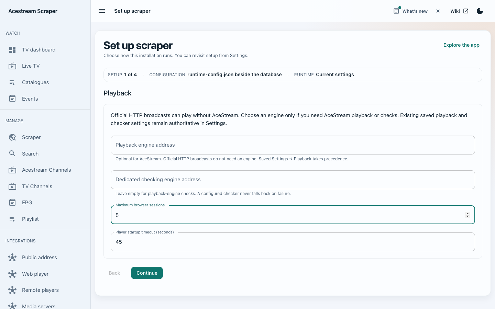
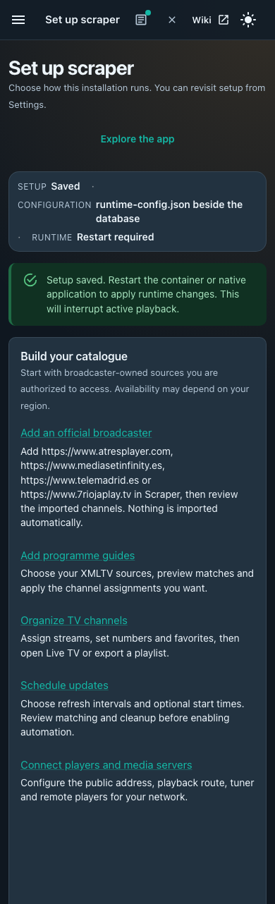

# Runtime configuration and first-run setup

Implementation audit, 2026-10-27, based on develop `f465f13` plus this change.
Recheck `backend/app/config/settings.py`, `backend/app/config/runtime-options.json`,
`entrypoint.sh`, `healthcheck.sh`, `warp-setup.sh`, `Dockerfile`,
`docker-compose.yml` and `docs/builder/runtime-options.json` when adding options.
This is an application/runtime change; private Jenkins policy is unchanged.

## Ownership and precedence

`runtime-config.json` version 1 lives beside the selected SQLite database. It is
separate from the legacy v1 `config.json`, which must not be overwritten. Docker
creates it before services start. Native startup creates it before provisioning
the database. Creation imports supported environment values once; native startup
also includes resolved `.env` and legacy application aliases. A file already on
disk always wins for migrated options, including explicit false/empty values.
Missing file keys use the registry defaults, not new environment values.

The file contains `version`, `setup_complete` and `runtime`. Runtime keys retain
their environment names for operator recognition. Unknown keys, commands, secrets,
invalid values, unsupported versions, oversized files and symlinks are rejected.
Saves use a stable advisory lock, optimistic revisions, a mode-0600 temporary file
and atomic replacement. The directory must be writable by the application user.
Do not mount only the individual file: atomic replacement needs its directory.

Saved database settings remain authoritative for playback, checker selection,
public address, schedules, link formats, tuner, notification webhooks and other
integrations. No bulk migration or source deletion is performed. A fresh database
no longer eagerly stores the default playback URL merely when Settings is read;
an explicit saved blank URL still disables it. Setup does not silently rewrite
these database preferences.

The authenticated `GET/PUT /api/v1/setup` API exposes only reviewed runtime data.
It runs file I/O in worker threads. It neither executes commands nor starts services.
Changes are pending until the application/container restarts. Docker health probes
read the boot snapshot in the supervisor run directory, so edits do not make a
healthy running instance probe services it has not started. Software availability
is derived from the installed image, never from writable file claims.

Fresh starts show an optional setup notice. Existing database files are marked
setup-complete during bootstrap, preserving their normal navigation. `/setup` is
always reachable from Settings. The wizard guides runtime choices and then links
to the existing source/guide/channel/automation/integration editors, which retain
their own reviewed save workflows. It imports no channels and performs no playback.

## Options moved into the file

The following table is generated from the reviewed runtime registry. These options
are available in the wizard; advanced controls are disclosed on Review. All need a
restart. Values passed with Docker `-e` or Compose seed only a missing file.

| Option | Wizard section | Default |
| --- | --- | --- |
| `ACE_ENGINE_URL` | playback | Empty |
| `ACE_CHECK_ENGINE_URL` | playback | Empty |
| `PLAYER_MAX_SESSIONS` | playback | `3` |
| `PLAYER_START_TIMEOUT_SECONDS` | playback | `45` |
| `PUBLIC_BASE_URL` | network | Empty |
| `ALLOW_PRIVATE_SCRAPE_TARGETS` | network | `true` |
| `TUNER_ALLOWED_NETWORKS` | network | `127.0.0.0/8,10.0.0.0/8,100.64.0.0/10,172.16.0.0/12,192.168.0.0/16,::1/128,fc00::/7,fe80::/10` |
| `FORWARDED_ALLOW_IPS` | network | `127.0.0.1,10.0.0.0/8,172.16.0.0/12,192.168.0.0/16` |
| `CORS_ORIGINS` | network | `http://localhost:3000` |
| `ENABLE_ACESTREAM_ENGINE` | services | `false` |
| `ENABLE_ACESTREAM_CHECK_ENGINE` | services | `false` |
| `ENABLE_ACEXY` | services | `false` |
| `ENABLE_IPFS` | services | `false` |
| `ENABLE_ZERONET` | services | `false` |
| `ENABLE_TOR` | services | `false` |
| `ENABLE_WARP` | services | `false` |
| `ACESTREAM_BIND_ALL` | services | `true` |
| `WARP_ENABLE_NAT` | services | `false` |
| `WARP_FORCE_IPV4` | services | `true` |
| `ZERONET_URL` | advanced | `http://127.0.0.1:43110` |
| `IPFS_GATEWAY_URL` | advanced | `http://127.0.0.1:8081` |
| `SCRAPER_TIMEOUT` | advanced | `10` |
| `SCRAPER_RETRIES` | advanced | `3` |
| `ZERONET_TIMEOUT` | advanced | `20` |
| `ZERONET_RETRIES` | advanced | `5` |
| `IPFS_TIMEOUT` | advanced | `30` |
| `IPFS_RETRIES` | advanced | `3` |
| `CHANNEL_CLEANUP_DAYS` | advanced | `30` |
| `MEDIA_SERVER_MIN_REFRESH_MINUTES` | advanced | `30` |
| `ACESTREAM_STATUS_TIMEOUT` | advanced | `10` |
| `EPG_PROGRAM_RETENTION_HOURS` | advanced | `24` |

## Options retained in deployment configuration

These cannot safely be presented as ordinary live app settings. Changing them
usually needs a container recreation, new mounts, credentials, or an image build.

| Category | Parameters reviewed | Reason |
| --- | --- | --- |
| Database location and legacy import | `DATABASE_URL`, `LEGACY_DATABASE_URL`, `SCRAPER_DB_URL`, `LEGACY_DB_URL` | Locate the database/config before reading it; retain backup-first migrations. |
| Private credentials | `API_TOKEN`, `TELEGRAM_ADMIN_TOKEN`, `TELEGRAM_KEY_FILE`, `WARP_LICENSE_KEY` | Keep secrets out of the wizard response and ordinary config backups. |
| Persistent and temporary paths | `PLAYER_HLS_DIR`, `ACESTREAM_HOME`, `ACESTREAM_GLUETUN_PORT_FILE`, `IPFS_PATH`, `ZERONET_DATA_DIR`, `TOR_DATA_DIR`, `TELEGRAM_SESSION_DIR`, `LOG_DIR`, `LOGROTATE_DIR`, `SUPERVISOR_RUN_DIR`, `TMPDIR` | Must agree with volumes, ownership and lifecycle cleanup; Telegram key/session storage remains separately mounted. |
| Ports and network bindings | `FLASK_PORT`, `ACESTREAM_HTTP_HOST`, `ACESTREAM_HTTP_PORT`, `ACEXY_HOST`, `ACEXY_PORT`, `ACEXY_LISTEN_ADDR`, `ACEXY_STATUS_PORT`, `IPFS_API_HOST`, `IPFS_API_PORT`, `IPFS_GATEWAY_PORT`, `IPFS_SWARM_PORT`, `ZERONET_UI_HOST`, `ZERONET_UI_PORT`, `ZERONET_FILESERVER_PORT` | Must agree with Docker published ports and external endpoints; unauthenticated service interfaces must remain deliberate. |
| Executables and launch overrides | `APP_COMMAND`, `ACESTREAM_START_COMMAND`, `ACEXY_START_COMMAND`, `IPFS_START_COMMAND`, `ZERONET_START_COMMAND`, `WARP_START_COMMAND`, `FFMPEG_BINARY_PATH`, `IPFS_BINARY_PATH`, `ZERONET_BINARY_PATH`, `ACESTREAM_BINARY_PATH`, `ACESTREAM_PYTHON_BIN`, `ACESTREAM_BIONIC_LINKER`, `ACESTREAM_BIONIC_LIBDIR`, `TORRC_PATH` | Host command/executable policy cannot be selected by a web setup document. |
| Sidecar initialization and shell arguments | `IPFS_PROFILE`, `ZERONET_TRACKERS`, `ZERONET_EXTRA_ARGS`, `WARP_EXCLUDE_HOSTS`, `ACEXY_NO_RESPONSE_TIMEOUT` | Initialization-only effects or values assembled into trusted shell commands; retain operator-controlled deployment inputs. |
| Supervision and diagnostics | `SUPERVISED_RESTART_DELAY_SECONDS`, `SUPERVISED_FAST_EXIT_LIMIT`, `SUPERVISED_FAST_EXIT_WINDOW`, `WARP_READY_ATTEMPTS`, `WARP_READY_INTERVAL`, `LOG_FILE_MAX_BYTES`, `LOG_FILE_BACKUP_COUNT`, `FASTAPI_DEBUG`, `DEBUG_ENABLE_QLOG`, `WARP_SLEEP` | Low-level process/recovery policy and capture settings remain boot-time operator controls. |
| Application packaging | `APP_NAME`, `DEBUG`, `FRONTEND_BUILD_PATH`, `FRONTEND_STATIC_DIR`, `DOCKER_ENVIRONMENT`, `TZ`, `ACESTREAM_INSTALL_METADATA` | Packaging, filesystem layout or container process timezone; schedule timezone remains in the database. |
| Compatibility | `ACESTREAM_ENGINE_URL`, `ZERONET_BASE_URL`, `CORS_ALLOW_ORIGINS`, `ENABLE_LEGACY_ENV_ALIASES` | The three migrated aliases seed canonical file keys on first boot. Other aliases still locate DB/frontend paths. Compatibility notices contain names only. The retired toggle does not disable aliases. |
| Image/build facts | `IMAGE_HAS_*`, `TARGET*`, build manifest/download/digest/version variables, installer roots, `PYTHON*`, `PIP_*`, `LD_LIBRARY_PATH` | Build/system inputs, not user settings. File contents cannot claim missing software is installed. |
| Internal derived state | `ACESTREAM_FORWARDED_PORT`, `SCRAPER_RUNTIME_LOADED`, `SCRAPER_LEGACY_ENV_NAMES`, collector/helper variables | Private process state; never imported into the document or editable through setup. |
| Retired | `FLASK_ENV` | No effect on the FastAPI runtime. |

Docker image/flavor/platform, host published ports, volume mappings, network mode,
capabilities, devices, shared-memory size, user IDs and restart policy remain in
Compose/the command builder. A web wizard cannot change the container that hosts it.
The existing builder still emits bootstrap environment options for compatibility
with published releases. Its manifest now marks ownership for every offered option.

## Source policy

A fresh Alembic database has no scraped URLs or streams. Broadcaster adapters are
available only when the operator adds their official source. No third-party
scraped catalogue is seeded. The prior default live E2E scenario contained third-party
catalogue/IPNS URLs and paid-channel search presets; it was test data, not an app
startup seed. It has been replaced by an inert scenario template. Live E2E runs now
require an explicit operator scenario. Unit fixtures use synthetic identifiers.
Existing user databases are preserved; operators can remove unwanted sources in
Scraper after reviewing their own installation.

## Validation boundaries

Test bootstrap once, old aliases, blank/false precedence, custom DB directories,
restart snapshots, malformed/unsupported/symlink files, stale writes, API auth,
capability rejection and empty fresh catalogues. UI tests cover both themes, draft
preservation, explicit saves, unavailable controls, retry and first-run notices.
The shell runtime contracts and browser viewport checks cover startup and layout.
Actual optional services and all CPU/image combinations still require Docker smoke
validation; unit/browser checks do not establish live stream availability.

## Local validation snapshot — 2026-10-27

Full-suite results below were collected on the working tree based on `e90b315`.
The follow-up quick gate and focused tests ran at `7a53ef1`, rebased onto develop
`f465f13`. These are local results, not Jenkins or release results.

- Full backend suite excluding Docker builds: **2,145 passed, 1 failed**. The
  remaining `test_real_ffmpeg_reads_guarded_hls_without_engine[subtitles]` failure
  reproduces with the temporary local FFmpeg 7.1 tool. Feeding its synthetic HLS
  fixture directly to that executable reports `Can't support the subtitle`;
  the runtime image uses the pinned FFmpeg 8.1.2 build. No test was suppressed.
  Temporary test executables were installed under `/tmp`, not added to project
  dependencies. Final configuration-specific tests: **16 passed**, including the
  negative guide-retention and JSON CORS compatibility cases.
- Full frontend suite: **93 suites / 563 tests passed**. Typecheck, zero-warning
  ESLint and `build:backend` passed. Vite still reports the existing player and
  data-grid chunks above 500 kB; the dependency install also reports existing npm
  package deprecations. These warnings were retained rather than suppressed.
- Browser wizard checks: **4 passed**, phone/desktop in light/dark modes, including
  explicit save, unavailable services, restart notice, reload, horizontal overflow
  and focus below the fixed navigation.
- A fresh temporary native application successfully booted, saved setup and
  restarted with the file winning over a changed environment value.
- Shell supervision checks: **49 passed**; the runtime contract script passed.
  Docker manifest metadata, command-builder ownership/defaults, strict legacy-path
  guard, Pages payload drift and whitespace checks passed.
- After committing the generated API artifacts and rebasing onto `f465f13`,
  `CI_USE_PREINSTALLED_DEPS=1 bash scripts/ci/run_v2_test_suite.sh --profile quick`
  passed, including committed-type drift, lint, typecheck, frontend build and Pages
  payload checks. This resolves the earlier pre-commit generated-type guard stop.
  The focused runtime-configuration and notification tests also passed: **36 passed**.
  Notification tests required local loopback-server permission; their initial
  sandboxed invocation could not bind sockets. No application changes were needed.
- Docker image/architecture smoke runs and live broadcaster playback were not run.
  Future verification should use the prepared CI runner with its pinned media tools.

## Wizard screenshots

Captured from the built application by the Playwright wizard checks above, using
mock API responses and synthetic setup values. These show desktop light mode and
phone dark mode; they do not establish live optional-service availability.

